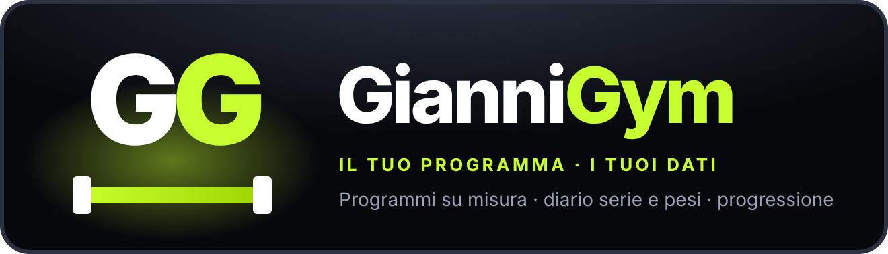
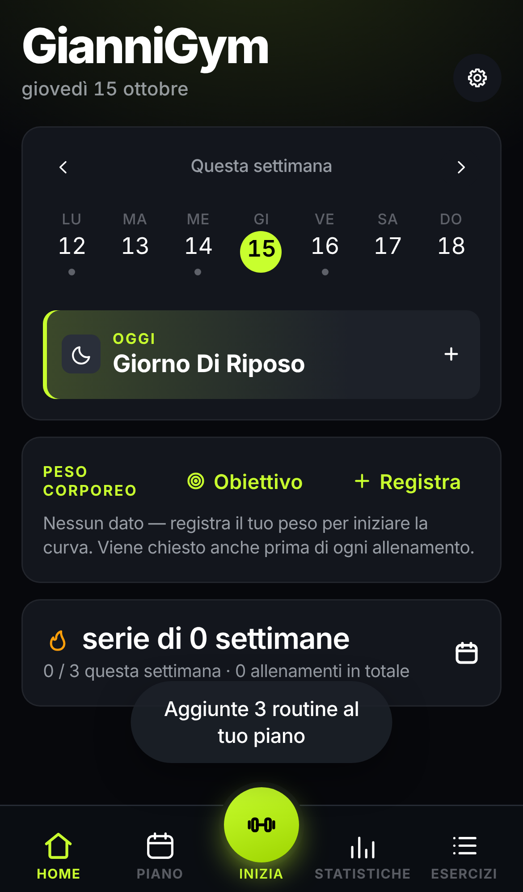
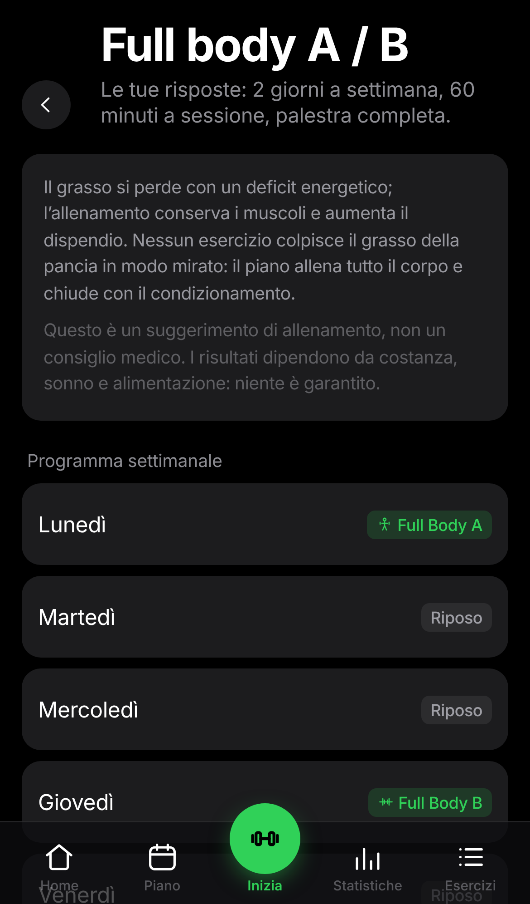
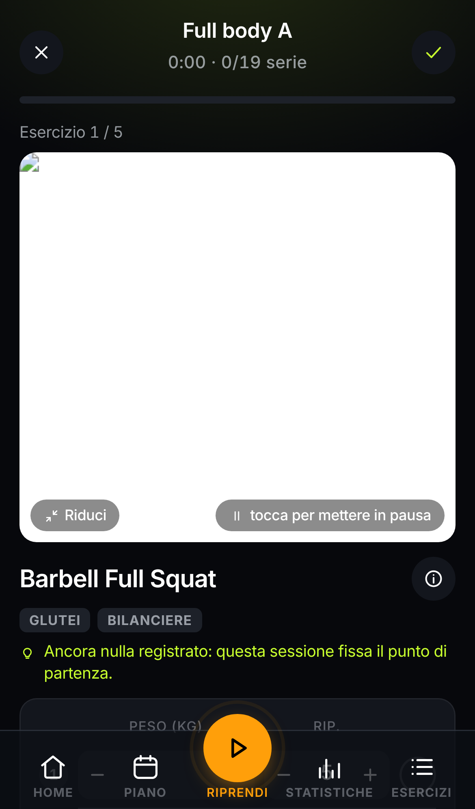
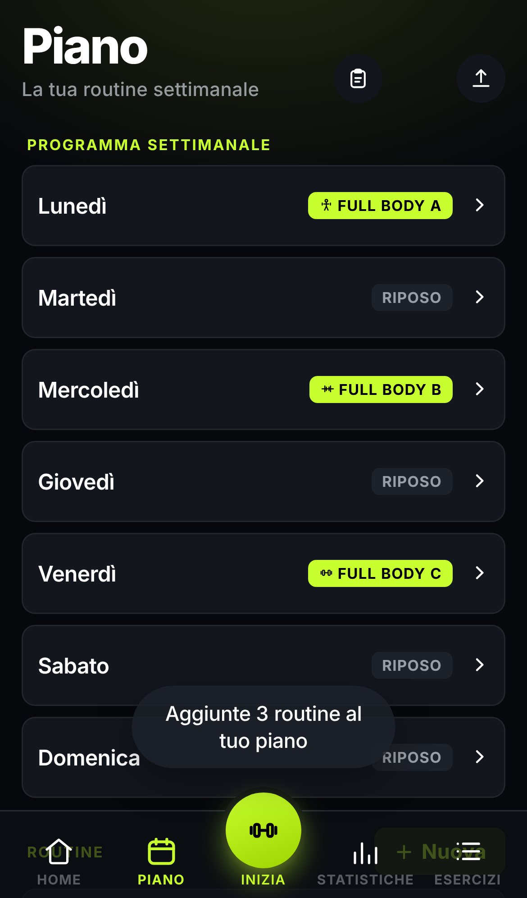
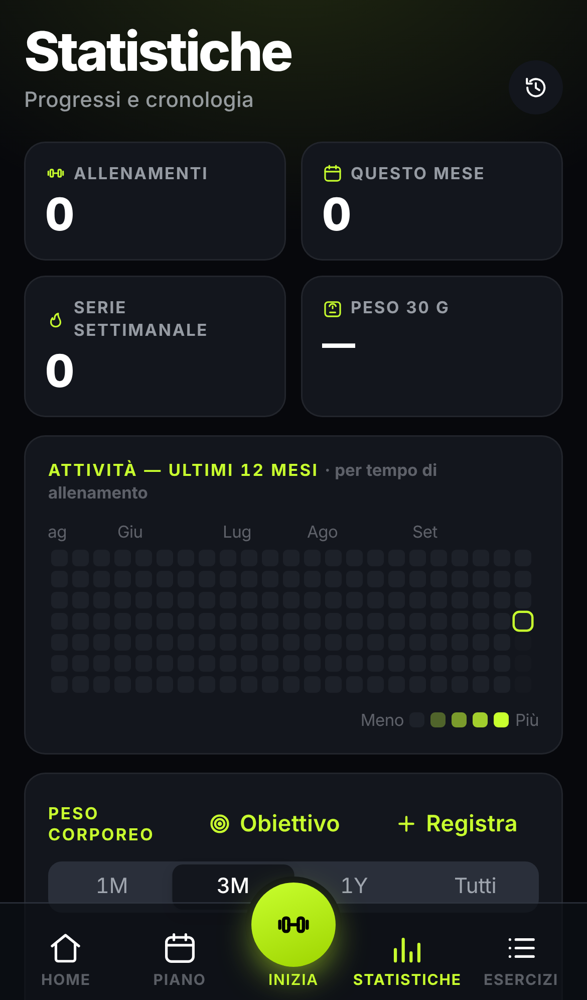
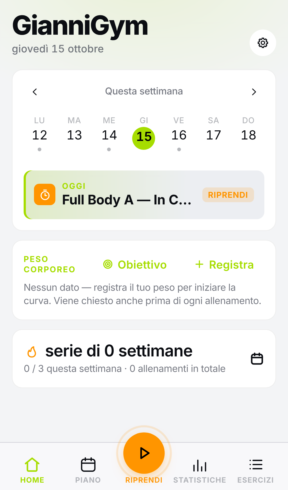

<div align="center">



<br>

**La tua palestra, il tuo programma, i tuoi dati.**

Rispondi a cinque domande e GianniGym costruisce il programma settimanale che entra davvero
nella tua agenda: i giorni che hai, i minuti che hai, l'attrezzatura che hai. Poi ti guida in
sala serie per serie, ricorda cosa hai sollevato l'ultima volta e alza i carichi quando è ora.

<br>

[](LICENSE)


<br>

[](https://github.com/Gvurpa91/Giannigym/issues)

</div>

<br>

<div align="center">
<table>
<tr>
<td align="center"><br><sub><b>Home</b> — l'allenamento di oggi</sub></td>
<td align="center"><br><sub><b>Generatore</b> — il programma spiegato</sub></td>
<td align="center"><br><sub><b>Allenamento</b> — serie, pesi, timer</sub></td>
</tr>
<tr>
<td align="center"><br><sub><b>Piano</b> — la settimana</sub></td>
<td align="center"><br><sub><b>Statistiche</b> — progressi e record</sub></td>
<td align="center"><br><sub><b>Tema chiaro</b> — stesso stile, di giorno</sub></td>
</tr>
</table>
</div>

## Cos'è

GianniGym è un fork personale di [openGym](https://github.com/DuarteSantos8/openGym), un tracker
per palestra e peso corporeo che gira su un server tuo. Tiene tutto quello che openGym sa fare e
aggiunge tre cose:

- **Un generatore di programmi che non ha bisogno dell'AI.** Obiettivo, esperienza, giorni,
  durata, attrezzatura: ne esce un piano completo, realistico nei tempi, con una spiegazione
  e delle alternative per ogni esercizio. Gira sul telefono, senza account e senza costi.
  **[Come funziona →](docs/PROGRAM_BUILDER.md)**
- **Un nome e un look nuovi.** Tema scuro profondo, accento "volt", titoli grandi: fatto per
  essere letto a colpo d'occhio tra una serie e l'altra.
- **Un piano per il futuro.** L'analisi per trasformarlo in un personal trainer con AI a
  pagamento, con schema dati, rischi e costi, è in [docs/PIANO_PT_AI.md](docs/PIANO_PT_AI.md).
  Non è ancora implementata: oggi l'app non chiama nessun servizio esterno.

Il Coach AI opzionale di openGym (da [alexpcosta](https://github.com/alexpcosta/openGym))
resta disponibile per chi si ospita il server e ha un proprio account Claude o ChatGPT:
[docs/AI_COACH.md](docs/AI_COACH.md).

## Cosa fa

**Programma**
- 📋 **Crea il mio programma** — cinque domande e una lista di esercizi da evitare producono
  la settimana: split giusto per i tuoi giorni (full body, upper/lower, push/pull/legs),
  fondamentali prima, serie e ripetizioni in base all'obiettivo, superset quando il tempo è
  poco, regola di progressione già impostata. Ogni esercizio dice *perché* c'è e con cosa
  puoi sostituirlo.
- 🗓️ **Piano settimanale** — una routine per giorno, su una libreria di **1.324 esercizi**
  con ricerca, filtro per attrezzatura e dimostrazioni animate. Sposta un allenamento se salti
  un giorno, senza toccare il piano.
- 🔗 **Superset, esercizi a tempo, cardio** — plank e sospensioni si registrano in secondi,
  la corsa in minuti e velocità, i superset uno dietro l'altro con un solo recupero.
- 📤 **Condividi il piano** — un file piccolo o un PDF pulito da mandare a chi vuoi.

**In sala**
- ▶️ **Allenamento guidato** — sa che giorno è e parte dalla sessione di oggi. Pesi
  precompilati dall'ultima volta, "Ultima volta: 60×10, 60×10, 60×8" sotto ogni esercizio,
  timer di recupero, schermo che resta acceso, record rilevati da solo.
- 📈 **Progressione automatica** — lineare, Greyskull LP, doppia progressione o a tempo.
  Se hai chiuso tutte le ripetizioni il carico sale e ti dice di quanto; se ne hai mancate
  resta uguale; dopo più stalli scarica. Gli esercizi a corpo libero progrediscono in
  ripetizioni.
- 💪 **1RM stimato** e **sforzo per serie** (RIR o RPE), se li vuoi.
- 🔔 **Notifiche** — timer di recupero anche ad app chiusa e promemoria nei giorni di
  allenamento.

**Progressi**
- ⚖️ **Peso corporeo** con obiettivo e grafico.
- 🟩 **Heatmap annuale** e **mappa muscolare** fronte/retro di ciò che hai allenato.
- 📥 **Importa lo storico** da FitNotes, Strong, Hevy e il peso da Apple Health.

**Tuo**
- 🔑 **Passkey** al posto delle password: Face ID, Touch ID, impronta.
- 📦 **Export e import** in un tap, modalità ospite, **nessuna telemetria**.
- 🌍 **12 lingue**, tema chiaro e scuro, 8 colori d'accento.

## Installare

### Sul tuo server (consigliato: sincronizzazione e passkey)

Serve [Docker](https://docs.docker.com/get-docker/) con Compose.

```bash
git clone https://github.com/Gvurpa91/Giannigym
cd Giannigym
cp .env.example .env
docker compose up -d --build
```

Apri **http://localhost:8080**, tocca **Crea profilo** e sei dentro. Al primo avvio scarica
una volta i media degli esercizi (circa 140 MB).

> Per usarla dal telefono fuori casa con le passkey serve un dominio HTTPS: due righe in
> `.env`. Guida completa in **[docs/SELF_HOSTING.md](docs/SELF_HOSTING.md)**.

### Su iPhone

Apri l'indirizzo del tuo server in Safari, tocca Condividi e poi **Aggiungi alla schermata
Home**. Si installa come app a schermo intero, con icona e funzionamento offline.

### App Android o iOS senza server

Lo stesso codice compila un'app nativa (Capacitor) con i dati solo sul telefono, senza
account e senza sincronizzazione: **[docs/MOBILE.md](docs/MOBILE.md)**.

## Come funziona

```
┌──────────────┐        ┌──────────────────────────────┐
│  Telefono /  │──HTTPS─▶│  web  (nginx)                │
│  computer    │        │   ├─ serve l'app             │
└──────────────┘        │   └─ inoltra /api ──────────┐│
                        └──────────────────────────────┘│
                                                         ▼
                                         ┌──────────────────────────┐
                                         │  api  (Node + WebAuthn)  │
                                         │   └─ ./data (file JSON)  │
                                         └──────────────────────────┘
```

- **frontend/** — React 19 + Vite (React Router, Zustand). Il generatore di programmi, la
  progressione e la stima dell'1RM sono funzioni pure in `frontend/src/lib/`, con i test
  accanto (`npm test`).
- **api/** — Node senza framework, una sola dipendenza (`@simplewebauthn/server`), tutto
  salvato come JSON sotto `./data`.
- **web/** — immagine Docker che compila il frontend e lo serve con nginx sulla stessa
  origine dell'API (le passkey lo richiedono).

## I tuoi dati

Stanno in `./data` sull'host: `db.json` (profili e chiavi pubbliche delle passkey),
`state-<utente>.json` (piano, allenamenti, peso, impostazioni di ciascuno) e `secret`.
**Copia `./data` e hai copiato tutto.** Le chiavi private delle passkey non arrivano mai al
server. Il modello di sincronizzazione è "vince l'ultimo salvataggio": per uso personale su
un telefono va benissimo.

## Configurazione

Tutto in `.env` (vedi `.env.example`):

| Variabile        | Cosa è                                                  | Default                 |
|------------------|---------------------------------------------------------|-------------------------|
| `RP_ID`          | Hostname a cui sono legate le passkey                   | `localhost`             |
| `ORIGIN`         | URL completo da cui è servita l'app                     | `http://localhost:8080` |
| `WEB_PORT`       | Porta sull'host                                         | `8080`                  |
| `RP_NAME`        | Nome mostrato nel prompt della passkey                  | `GianniGym`             |
| `ADMIN_UIDS`     | Id utente con la dashboard admin (separati da virgola)  | *(nessuno)*             |
| `INVITE_ONLY`    | Richiedi un codice invito per creare un profilo         | *(off)*                 |
| `COACH_DISABLED` | Forza il Coach AI spento                                | *(non impostato)*       |

## Sviluppo

```bash
cd frontend && npm ci && npm run dev     # app su http://localhost:5173
cd frontend && npm test                  # test del generatore, progressione, 1RM, storico
cd api && npm ci && npm test             # test dell'API e del Coach
node scripts/check-locales.mjs           # le 11 lingue devono avere le stesse chiavi
```

## Roadmap

- [x] Generatore di programmi senza AI, con spiegazioni e alternative
- [x] Nuovo design e icone
- [ ] Personal trainer con AI a pagamento (analisi in [docs/PIANO_PT_AI.md](docs/PIANO_PT_AI.md))
- [ ] Misure corporee (vita, braccia…) accanto al peso
- [ ] Note per esercizio e calcolatore dei dischi
- [ ] Programmi a percentuale (stile 5/3/1) sopra il motore di progressione

## Origine e licenza

GianniGym nasce da [DuarteSantos8/openGym](https://github.com/DuarteSantos8/openGym), passando
per il fork con Coach AI di [alexpcosta](https://github.com/alexpcosta/openGym). Grazie a
entrambi: senza il loro lavoro questo progetto non esisterebbe.

[GNU AGPL v3.0](LICENSE): libero e open source. Puoi ospitarlo, usarlo, modificarlo e
condividerlo; se pubblichi una versione modificata come servizio in rete devi offrirne il
codice con la stessa licenza.

Le immagini e le GIF degli esercizi vengono dal dataset
[hasaneyldrm/exercises-dataset](https://github.com/hasaneyldrm/exercises-dataset) e
mantengono i propri termini: vedi [NOTICE.md](NOTICE.md).
